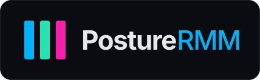
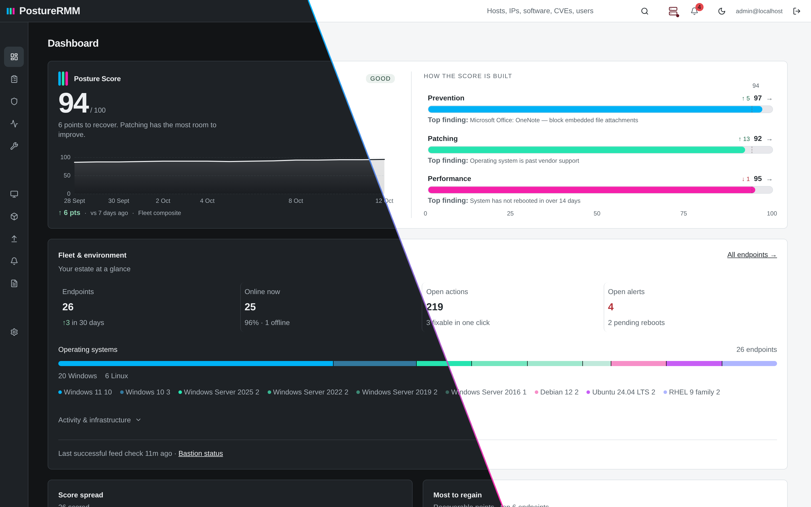

<!-- Mirrored verbatim to PostureRMM/PostureRMM as README.md; never edit on the hub.
Each release publishes it there (deploy/release/check-public-docs.sh). Its links resolve on the hub. -->

<div align="center">



**Endpoint management, security and compliance in one self-hosted platform.**

Manage, patch, deploy, remote into, harden, audit and remediate your Windows endpoints and Linux servers —
from one console, on your own hardware, with your fleet data never leaving it.

**PostureRMM is in beta. It is free for up to 50 endpoints, with every feature. Paid plans are not available yet.**

</div>

<div align="center">

</div>

---

## What it does

Most tools in this space stop at telling you what is wrong. PostureRMM closes the loop: it finds
the problem, fixes it, then **re-measures to prove the fix worked** — and if it didn't, it says so
rather than reporting the API call as a success.

| Area | Capabilities |
|---|---|
| **Compliance** | Audit Windows and Linux servers against DISA STIG, Microsoft Security Baselines and a curated hardening profile. Failing checks carry authored fixes that apply per-endpoint, per-check across the fleet, or as "apply all safe fixes" — behind a safety gate that refuses anything which would cut your own access. Every fix is verified by re-running the check, and every fix is revertible, because each executor captures the state it overwrote. |
| **Patching** | Windows updates scanned **offline** against Microsoft's own applicability engine — no internet needed on the endpoint or the server. Linux package updates from the distribution's own advisories, installed from packages your own server carries. Third-party app updates from a curated catalogue. CVE correlation across NVD, EPSS, MSRC, CISA KEV and GHSA with version-range-aware matching. Deployment policies with canary pauses, maintenance windows and an optional supply-chain bake period. |
| **Software** | Curated app catalogue with one-click install and uninstall, custom `.msi`/`.exe`/`.msix` upload, registry-verified installs with exit-code classification and tiered retry, full software inventory on Windows and Linux, and an application blocklist for rival agents and unapproved remote-access tools. |
| **Remote access** | Browser-based remote desktop (Windows), a real terminal, file browse/upload/download, and PowerShell, `sh` or `bash` execution with an approval workflow and live output — no separate tool, no separate agent. |
| **Fleet** | Rule-based dynamic groups, ARP network discovery for unmanaged devices, hardware and disk-health inventory, per-endpoint reachability history, maintenance windows, reboot policies with end-user deferral, alerting over webhook and email with delivery health you can see, and custom monitors that run on the agent and alert through the same channels. |
| **Access & audit** | OIDC single sign-on, five-role RBAC with group scoping, TOTP 2FA, scoped API keys, an audit trail you can forward off-host over TLS syslog, escrowed BitLocker recovery keys and local administrator passwords, a multi-tenant data model, and a read-only "view as" lens so you can check RBAC is what you think it is. |

## The Posture Score

Three pillars, equally weighted, composing one number that drills all the way down to the check or
telemetry sample that produced it.

| Pillar | Covers |
|---|---|
| **Prevention** | DISA STIG, Microsoft Security Baseline, PostureRMM Recommended hardening, mandate crosswalks |
| **Patching** | CVE exposure, patch latency and cadence, OS and application end-of-life |
| **Performance** | Disk health and fill projection, SMART/NVMe wear, thermal throttling, battery health, reboot age, time-sync drift, service state |

Unmeasured surface **shrinks the maximum** rather than counting as failure, so a score is never a
guess dressed up as a number. An empty fleet reads "not yet established", not zero.

## What's in the box

**4,336 atomic compliance checks** across eighteen platforms, imported from upstream DISA SCAP/XCCDF,
the Microsoft Security Compliance Toolkit and ComplianceAsCode by dedicated importers — not
hand-transcribed — alongside PostureRMM's own curated hardening checks:

| Platform | Checks |
|---|---|
| Windows 11 · 10 | 573 · 515 |
| Windows Server 2022 · 2019 · 2016 · 2025 | 458 · 453 · 338 · 494 |
| Microsoft 365 Apps · Edge · Chrome · Firefox · Acrobat Reader | 202 · 79 · 39 · 26 · 2 |
| Ubuntu 22.04 · 24.04 · 26.04 | 103 · 103 · 66 |
| Debian 12 · 13 | 208 · 208 |
| RHEL 9 · 10 (and Rocky, AlmaLinux) | 249 · 220 |

Plus **seven mandate crosswalks** — HIPAA, PCI DSS v4, SOC 2 CC, ISO 27001 Annex A, CMMC L1 and L2,
and Cyber Essentials — mapping regulatory controls back to the checks that answer them, and the ACSC
Essential Eight as a coverage lens on Windows that reports what is measured and never claims a
maturity level.

Checks are YAML, not code. So is every posture rule. You can read them, and so can your auditor.

## Offline by design

**The product runs with no internet at all.** Enrollment, compliance scanning, remediation, patch
installation, software deployment, remote desktop, reporting — all of it happens on your network. Your
endpoints never reach out. Neither does the backend. Even Windows Update scanning is done offline,
against Microsoft's own applicability engine, so an endpoint never contacts Microsoft either.

The internet buys exactly one thing: **fresh content.** New CVEs, patch payloads, updated
compliance baselines, the app catalogue. That arrives by *hydration* — a single component, the
Bastion, pulls from a static feed on Cloudflare R2 on a schedule you set. Open egress for a
maintenance window, let it fill up, close it again. Anything the backend asks for while the door
is shut queues durably and drains the moment it opens, with no operator action and nothing to
re-request.

Almost nothing goes the other way. Your install has an opaque identifier, and it is sent with every
feed request; each license check adds your version, tier and active endpoint count. Nothing about your endpoints or their contents ever leaves your server —
we never learn which machines you run, what is on them, or what failed a check. There is no inbound
path to your backend and no way for us to reach it. No activation and no licence token are needed.
The identifier is shown in the product with this same sentence beside it.

First install and first enrollment work with the door shut too: the agent installer travels inside
the offline bundle.

## Architecture

RMM is the most abused software category there is — see [LOLRMM](https://lolrmm.io). PostureRMM is
built so it cannot become another entry on that list: your backend accepts **no inbound connection
from us**, and cannot be reached by us at all.

```
        ┌────────────────────┐
        │  PostureRMM Feed   │   threat intel, patch metadata, app catalog
        └─────────┬──────────┘
                  │ HTTPS, outbound only, on your schedule
┌─────────────────┼───────────────────────────────────────────┐
│ YOUR NETWORK    ▼                                           │
│   Bastion (Rust) ── the only component that reaches out     │
│      │                                                      │
│      ▼                                                      │
│   Backend (Rust) ── TLS edge, API, admin UI, scheduler      │
│      │              zero outbound internet                  │
│      ├── PostgreSQL                                         │
│      └── Agents (Rust) ── Windows or Linux, no runtime deps │
└─────────────────────────────────────────────────────────────┘
```

Run the Bastion always-on and your fleet stays current continuously; run it behind a door you open
once a month and your fleet stays current as far back as your last sync. Both are first-class —
neither is a degraded mode.

There is no cloud version to migrate you to.

## Quick Start

```bash
mkdir posturermm && cd posturermm
curl -LO https://github.com/PostureRMM/PostureRMM/releases/latest/download/docker-compose.yml
curl -LO https://github.com/PostureRMM/PostureRMM/releases/latest/download/preflight.sh
chmod +x preflight.sh && ./preflight.sh
```

On Windows 10 or 11 with [Docker Desktop](https://docs.docker.com/desktop/setup/install/windows-install/),
in PowerShell:

```powershell
mkdir posturermm; cd posturermm
curl.exe -LO https://github.com/PostureRMM/PostureRMM/releases/latest/download/docker-compose.yml
curl.exe -LO https://github.com/PostureRMM/PostureRMM/releases/latest/download/preflight.ps1
powershell -ExecutionPolicy Bypass -File .\preflight.ps1
```

Nothing to edit — no values to choose, no certificates, no DNS. Requirements, Docker Desktop's
licence, first login and the air-gapped install: **[docs/quickstart.md](docs/quickstart.md)**.

## Configuration

**Every setting is optional, and a default install sets none of them.** `preflight.sh` (`preflight.ps1` on Windows) generates
the database password and records this host's address; the server generates its session key, TLS
certificate and bastion secret on first start.

Reach for **[docs/configuration.md](docs/configuration.md)** when you want a real hostname, a
different port, your own certificate, a split deployment, the content feed, or log and audit
tuning — not before installing.

Running it in earnest — TLS with your own certificate, a Bastion in a DMZ, the segment proxy,
backup and restore, upgrades, metrics and troubleshooting — is
**[docs/PRODUCTION.md](docs/PRODUCTION.md)**.

## Support and downloads

Everything is here on GitHub for now — there is no support portal, no ticket system, and no
separate download site.

- [**Discussions**](https://github.com/PostureRMM/PostureRMM/discussions) — questions, how-tos,
  anything you would otherwise ask a colleague
- [**Issues**](https://github.com/PostureRMM/PostureRMM/issues) — bugs and feature requests
- [**Releases**](https://github.com/PostureRMM/PostureRMM/releases) — the latest release: the compose
  file, the preflight scripts, the offline bundle, the agent installers
- [**Security policy**](SECURITY.md) — report a vulnerability here, never as a public issue

## License

Proprietary — see [LICENSE](LICENSE). No redistribution or rebranding of our builds. It is short and
written to be read.

The free cap is not a trial, not a feature-limited edition, not "free for personal use". SSO,
the full posture model, all compliance content, remote access and every report are in it.
