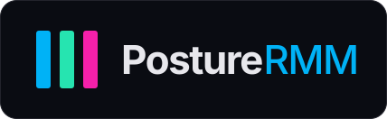
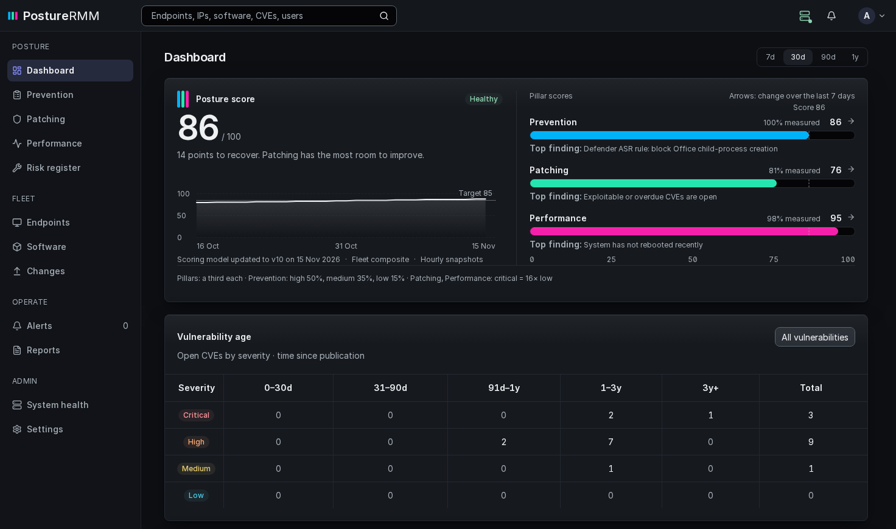
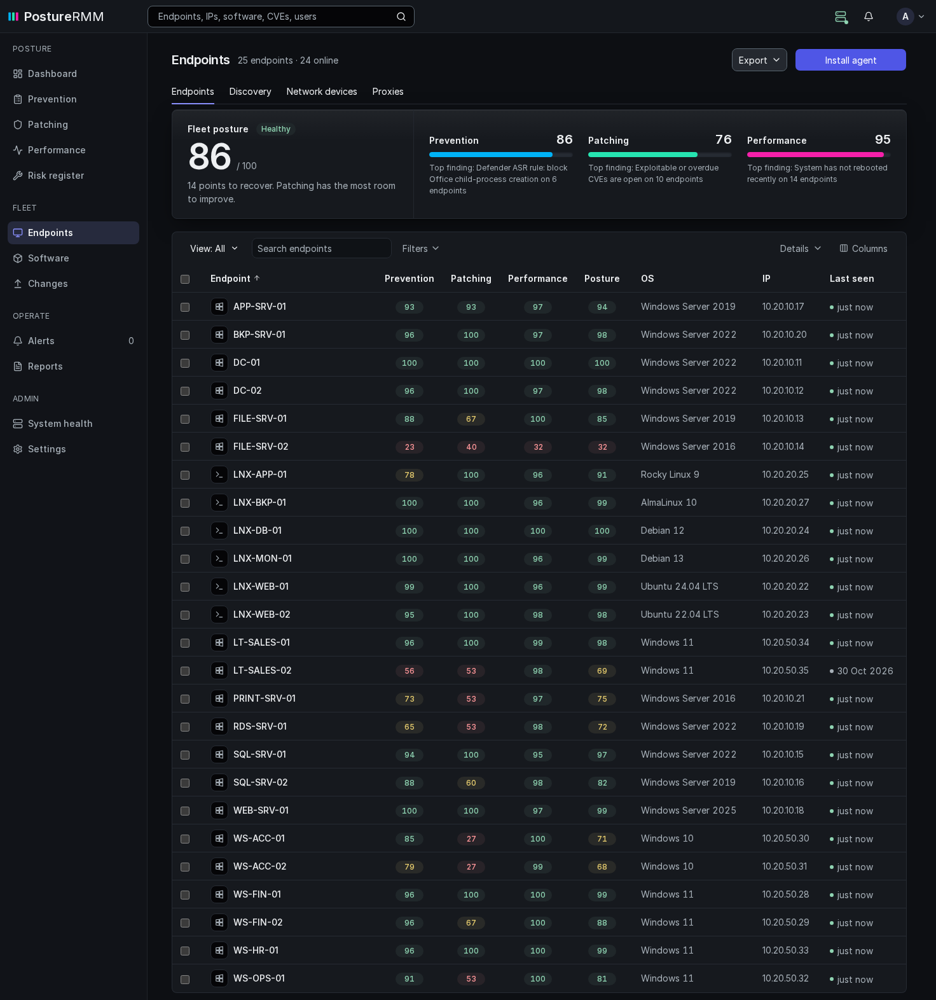
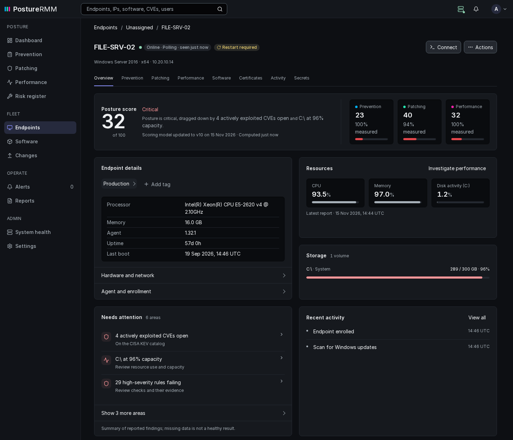
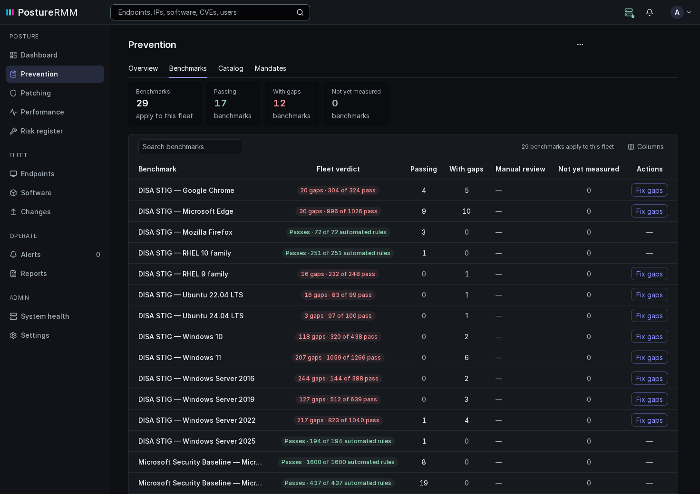
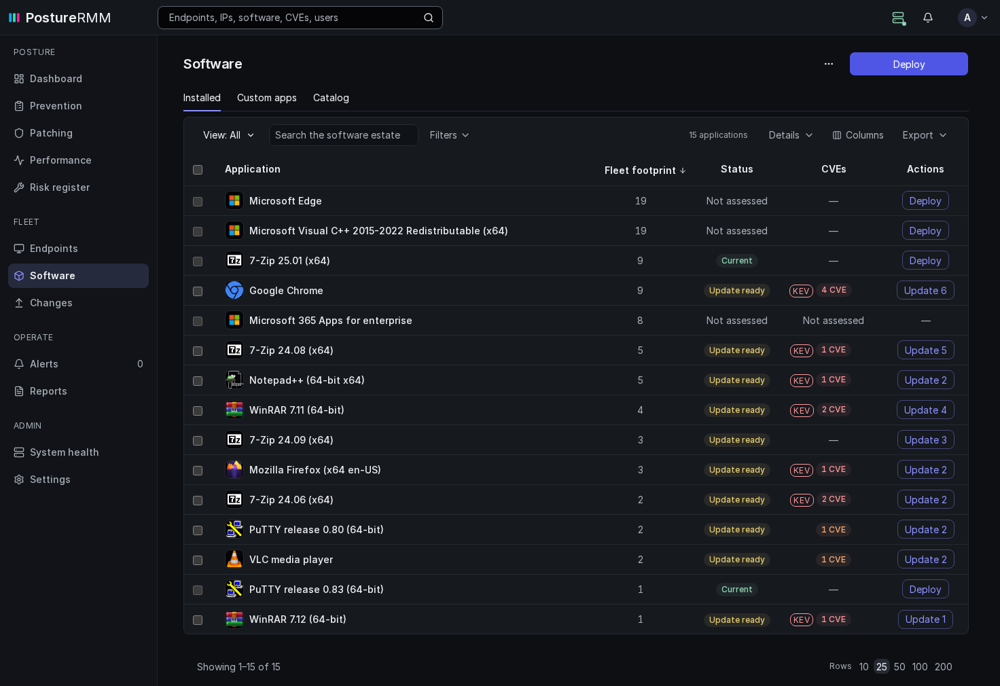
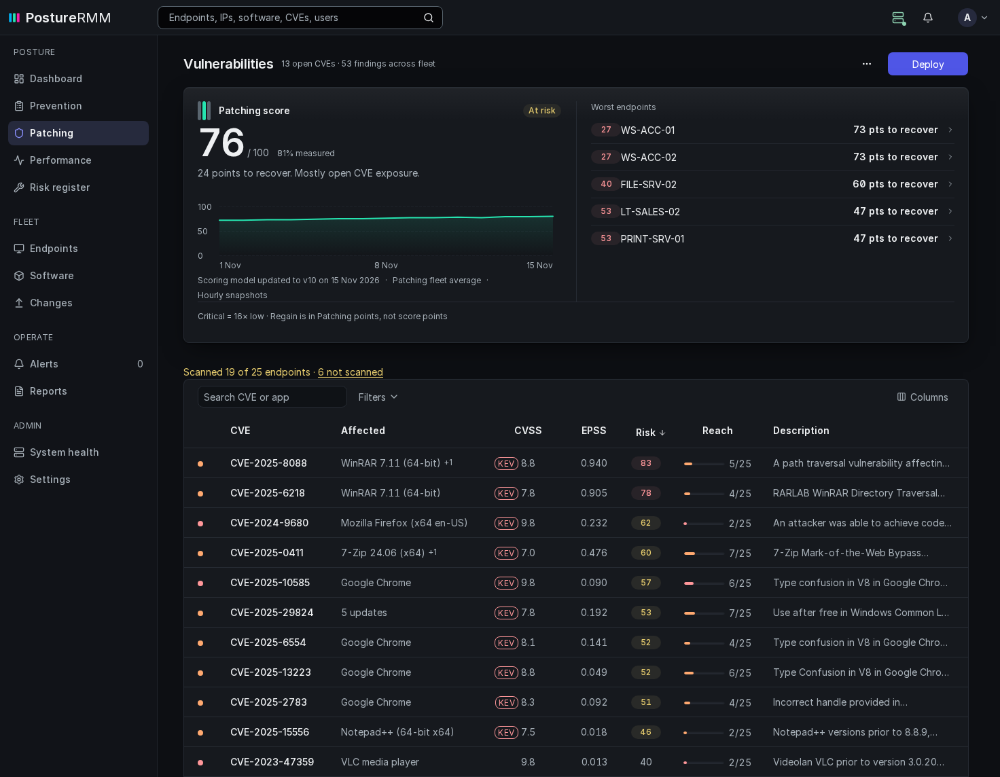
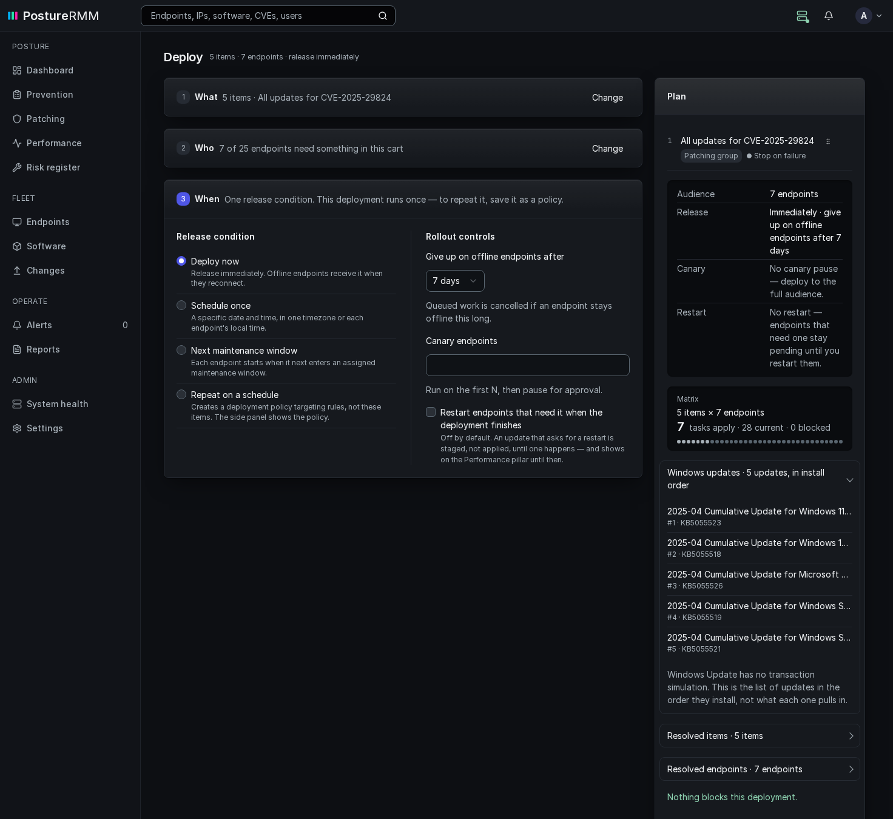
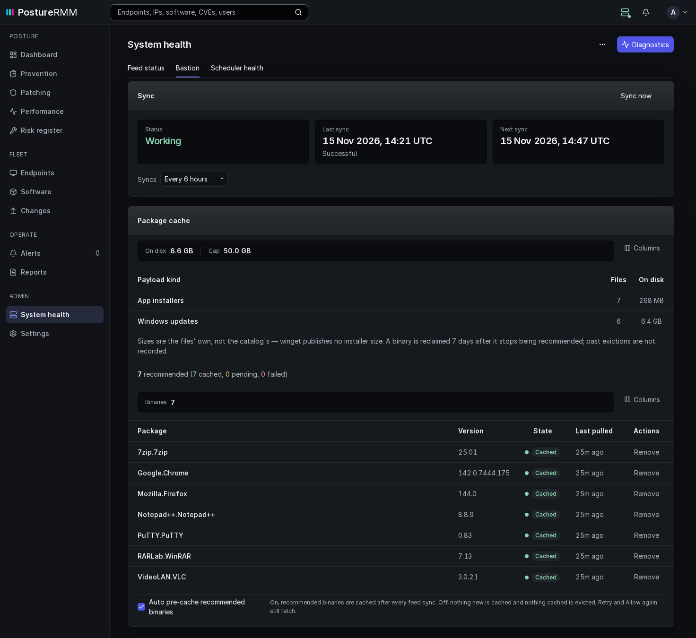

<!-- Mirrored verbatim to PostureRMM/PostureRMM as README.md; never edit on the hub.
Each release publishes it there (deploy/release/check-public-docs.sh). Its links resolve on the hub. -->

<div align="center">



### Endpoint management, patching, vulnerabilities and compliance.<br/>One self-hosted console. Private and secure by design.

[](https://github.com/PostureRMM/PostureRMM/releases/latest)


**[Quick start](#quick-start)** · **[Docs](docs/quickstart.md)** · **[Releases](https://github.com/PostureRMM/PostureRMM/releases)** · **[Discussions](https://github.com/PostureRMM/PostureRMM/discussions)**

</div>

https://github.com/user-attachments/assets/346e3e1e-52cd-41ad-b672-5609b09331bc

## What it is

A self-hosted RMM for Windows and Linux fleets that also tells you how secure they are, then fixes it.

- **Manage:** patching (Windows, Linux, third-party apps), software deployment, remote desktop and terminal, monitoring and alerts.
- **Secure:** CVEs matched to what's actually installed, plus thousands of DISA STIG and Microsoft baseline checks with one-click fixes that are re-checked afterwards.
- **Private:** nothing connects in, and your fleet data never leaves your network.
- **Free:** every feature, up to 50 endpoints.

## Quick start

On a Linux host with nothing else to prepare:

```bash
mkdir posturermm && cd posturermm
curl -LO https://github.com/PostureRMM/PostureRMM/releases/latest/download/docker-compose.yml
curl -LO https://github.com/PostureRMM/PostureRMM/releases/latest/download/preflight.sh
chmod +x preflight.sh && sudo ./preflight.sh
```

No values to choose, no certificates, no DNS. Open the address it prints, sign in, and enroll your first endpoint. First login, requirements and air-gapped installs are in **[docs/quickstart.md](docs/quickstart.md)**.

<details>
<summary><b>Trying it on a Windows 10 or 11 PC</b></summary>

<br/>

Do the numbered steps under "Before you start" in **[docs/quickstart.md](docs/quickstart.md#install-on-windows)** first, then in PowerShell:

```powershell
mkdir posturermm; cd posturermm
curl.exe -LO https://github.com/PostureRMM/PostureRMM/releases/latest/download/docker-compose.yml
curl.exe -LO https://github.com/PostureRMM/PostureRMM/releases/latest/download/preflight.ps1
powershell -ExecutionPolicy Bypass -File .\preflight.ps1
```

Windows Server can't host the server, because Docker Desktop runs on Windows 10 and 11 only. Run a small Linux VM in Hyper-V and use the Linux install instead. Windows Server stays a supported endpoint.

</details>

<details>
<summary><b>Features and the Posture Score</b></summary>

<br/>

Three pillars, equally weighted, rolled into one Posture Score that drills down to the check or measurement behind it.

| Pillar | What it measures |
|---|---|
| **Prevention** | DISA STIG, Microsoft Security Baselines and the PostureRMM Recommended hardening profile |
| **Patching** | CVE exposure, patch latency, and operating system and application end of life |
| **Performance** | Disk health and fill, SSD wear, thermal throttling, battery health, reboot age, time sync and services |

What isn't measured yet lowers the maximum instead of counting as a failure, so a score is never a guess. A new fleet reads "not yet established", not zero.

**Everything in the box**

| | |
|---|---|
| **Compliance** | STIG and baseline audits for Windows and Linux. Authored fixes per endpoint or across the fleet, behind a safety gate that refuses anything that would cut off your own access. Every fix is re-checked and can be reverted. Crosswalks for HIPAA, PCI DSS, SOC 2, ISO 27001, CMMC and Cyber Essentials. |
| **Patching** | Windows updates scanned against Microsoft's own applicability engine, with no internet needed on the endpoint. Linux updates from the distribution's own advisories. Third-party apps from a curated catalog plus every app in winget. Canary rollouts and maintenance windows. |
| **Vulnerabilities** | CVE matching across NVD, MSRC, GHSA, EPSS and CISA KEV, aware of version ranges, for software and the operating system. |
| **Software** | Inventory on Windows and Linux, one-click install and uninstall, your own `.msi`, `.exe` or `.msix` packages, and a blocklist for unapproved remote-access tools. |
| **Remote access** | Remote desktop in the browser, a real terminal, file transfer, and scripts with approval and live output. No separate tool, no separate agent. |
| **Fleet** | Dynamic groups, network discovery, hardware and disk-health inventory, reboot policies with user deferral, custom monitors, and alerts to email, webhooks, Slack, Teams and more. |
| **Access and audit** | OIDC single sign-on, role-based access with group scoping, 2FA, scoped API keys, an audit trail you can forward over syslog, and escrowed BitLocker and local admin passwords. |

</details>

<details>
<summary><b>Screenshots</b></summary>

<br/>

Every screen is the product running against a demo fleet of 25 endpoints: made-up hostnames, real public CVEs.

















</details>

<details>
<summary><b>Compliance content: eighteen platforms</b></summary>

<br/>

**4,406 atomic compliance checks**, imported from upstream DISA SCAP/XCCDF, the Microsoft Security Compliance Toolkit and ComplianceAsCode by dedicated importers, not hand-transcribed, alongside PostureRMM's own hardening checks.

| Platform | Checks |
|---|---|
| Windows 11 · 10 | 573 · 515 |
| Windows Server 2022 · 2019 · 2016 · 2025 | 458 · 453 · 338 · 494 |
| Microsoft 365 Apps · Edge · Chrome · Firefox · Acrobat Reader | 202 · 79 · 39 · 26 · 2 |
| Ubuntu 22.04 · 24.04 · 26.04 | 103 · 103 · 65 |
| Debian 12 · 13 | 208 · 208 |
| RHEL 9 · 10 (and Rocky, AlmaLinux) | 249 · 291 |

Seven mandate crosswalks (HIPAA, PCI DSS v4, SOC 2 CC, ISO 27001 Annex A, CMMC L1 and L2, Cyber Essentials) map regulatory controls to the checks that answer them, and the ACSC Essential Eight is a coverage lens that reports what is measured and never claims a maturity level. Checks and posture rules are YAML, not code: you can read them, and so can your auditor.

</details>

<details>
<summary><b>How it stays private</b></summary>

<br/>

Remote management tools are among the most abused software there is (see [LOLRMM](https://lolrmm.io)). PostureRMM is built so it can't become another entry on that list: your server accepts no inbound connection from us and can't be reached by us at all.

```
        ┌────────────────────┐
        │  PostureRMM Feed   │   threat intel, patch metadata, app catalog
        └─────────┬──────────┘
                  │ HTTPS, outbound only, on your schedule
┌─────────────────┼───────────────────────────────────────────┐
│ YOUR NETWORK    ▼                                           │
│   Bastion (Rust) ── the only component that reaches us      │
│      │                                                      │
│      ▼                                                      │
│   Backend (Rust) ── TLS edge, API, admin UI, scheduler      │
│      │              outbound: only what you configure       │
│      ├── PostgreSQL                                         │
│      └── Agents (Rust) ── Windows or Linux, no runtime deps │
└─────────────────────────────────────────────────────────────┘
```

- **Everything runs on your network.** Enrollment, scanning, fixes, patch installs, software deployment, remote desktop and reports. Endpoints never reach out, and even Windows Update scanning happens without contacting Microsoft.
- **The internet only brings fresh content:** new CVEs, patches, baselines and the app catalog. The Bastion fetches it on your schedule. Leave it always on, or open the door for a maintenance window and close it again; anything requested meanwhile queues and goes out next time.
- **Almost nothing leaves.** Your install sends an opaque identifier with each content request, and its version, tier and endpoint count with each licence check. Nothing about your endpoints, what's on them or what failed a check ever leaves your server. No activation, no licence token.
- **No cloud version** to migrate you to.

</details>

<details>
<summary><b>System requirements</b></summary>

<br/>

| | Server (backend and database) | Bastion |
|---|---|---|
| **CPU** | 2 vCPU | 1 vCPU |
| **RAM** | 4 GB on Linux; 8 GB on a Windows PC (Docker Desktop gives containers half of it) | 1 GB |
| **Disk** | 10 GB to install; plan 40 GB if you will deploy software and patches | 10 GB; its package cache is capped at 50 GB and holds only what you ask for |
| **OS** | Linux x86-64, or Windows 10 or 11 with Docker Desktop to try it | The same, or any Linux host that runs containers |
| **Runtime** | Docker Engine 20.10+ with Compose v2, or Podman 5+ as root | The same |

By default the Bastion runs beside the server, so one machine covers both. `preflight.sh` installs a container runtime for you on Debian, Ubuntu, RHEL, Rocky and AlmaLinux. These figures leave generous headroom: a nine-endpoint demo fleet ran the backend in about 230 MB of RAM at peak.

</details>

<details>
<summary><b>Upgrading</b></summary>

<br/>

**Back up first** ([how](docs/PRODUCTION.md#backup--restore)): database migrations can't be undone. Then, in the folder holding your `docker-compose.yml` (in PowerShell use `curl.exe -LO`; on Linux put `sudo` before `docker`):

```bash
curl -LO https://github.com/PostureRMM/PostureRMM/releases/latest/download/docker-compose.yml
docker compose pull
docker compose up -d
```

Agents upgrade themselves once the server has the new agent, wherever an upgrade policy covers them. What changed in every release you're skipping: the [release notes](docs/release-notes.md).

</details>

<details>
<summary><b>Configuration and production</b></summary>

<br/>

Every setting is optional, and a default install sets none. `preflight` generates the database password and records the host's address; the server generates its session key, TLS certificate and Bastion secret on first start.

- **[docs/configuration.md](docs/configuration.md)**: a real hostname, another port, your own certificate, a split deployment, logging and audit.
- **[docs/PRODUCTION.md](docs/PRODUCTION.md)**: running it in earnest, with a Bastion in a DMZ, the segment proxy, backup and restore, metrics and troubleshooting.

</details>

## Feedback and support

PostureRMM is in beta, built by one person, and every bit of feedback helps: bugs, ideas, or "why would anyone need this".

- **[Discussions](https://github.com/PostureRMM/PostureRMM/discussions)** for questions and ideas
- **[Issues](https://github.com/PostureRMM/PostureRMM/issues)** for bugs and feature requests
- **[Releases](https://github.com/PostureRMM/PostureRMM/releases)** for the compose file, preflight scripts, offline bundle and agent installers
- **[Security policy](SECURITY.md)** to report a vulnerability privately, never as a public issue

## License

Proprietary: see [LICENSE](LICENSE), which is short and written to be read. Free for up to 50 endpoints with every feature. That's not a trial, not a cut-down edition and not "personal use only". Paid plans aren't available yet.
